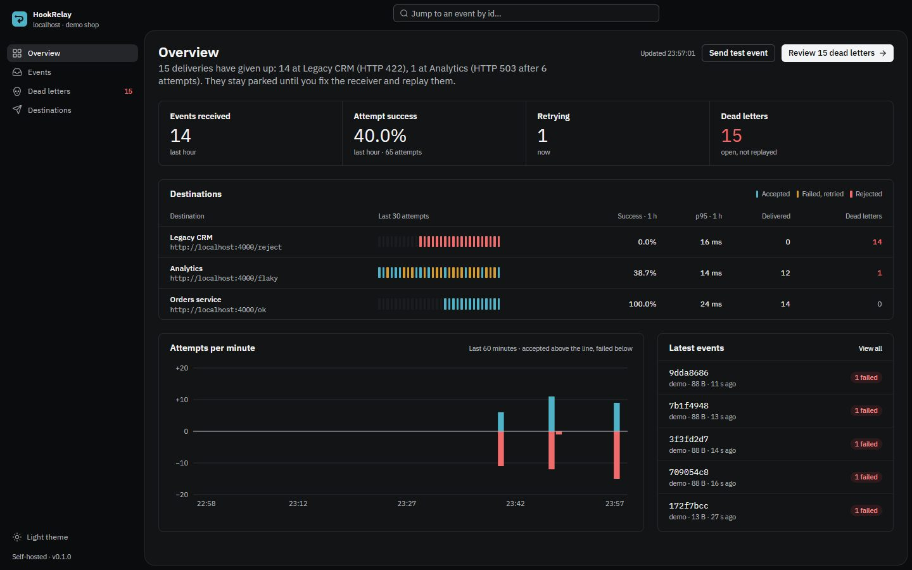
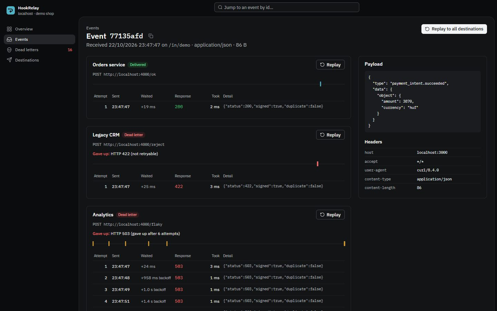
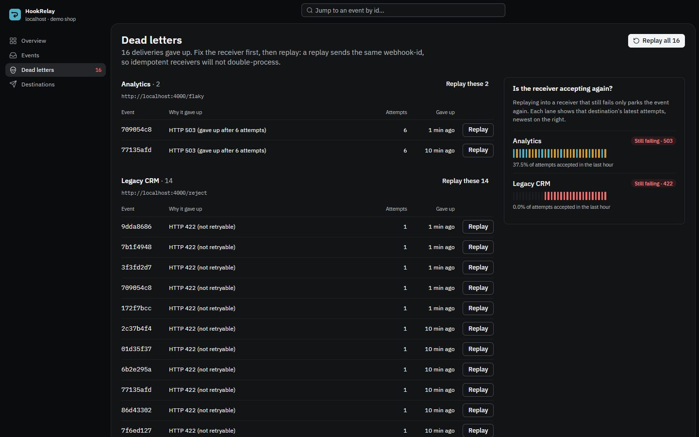
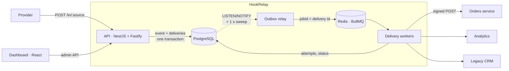

# HookRelay

A self-hostable webhook gateway. It accepts webhooks from providers like Stripe, Barion or
GitHub, stores them durably, and delivers them to your services with signed requests,
retries with backoff, a dead-letter queue and one-click replay.



## Why

A provider retries a failed webhook a few times and then gives up. If your service is
deploying, down or slow at that moment, the event is gone, and you find out when a
customer asks where their order is. HookRelay sits in front of your services:
- **Accept fast, never lose.** Ingest answers `202` only after the event is committed to
  Postgres, in the same transaction as one delivery row per destination (transactional
  outbox). Redis can be wiped without losing an event.
- **Deliver until it lands.** Exponential backoff with full jitter, `Retry-After` honoured,
  per-destination attempt budgets. `4xx` responses are treated as permanent and parked
  immediately instead of being hammered.
- **See and fix.** Every attempt is recorded. The dashboard shows each destination as a lane
  of its latest attempts, explains every failure, and replays dead letters once the receiver
  is fixed.

## Features

|              |                                                                                                                                                                 |
| ------------ | --------------------------------------------------------------------------------------------------------------------------------------------------------------- |
| Ingest       | Any content type, stored byte for byte; idempotent on `webhook-id` / `Idempotency-Key`                                                                          |
| Fan-out      | One source, many destinations; pause a destination without losing its retries                                                                                   |
| Signing      | [Standard Webhooks](https://www.standardwebhooks.com/) (`webhook-id`, `webhook-timestamp`, `webhook-signature`), verified against the official library in tests |
| Retries      | Full-jitter exponential backoff (1 s → 10 min cap), `Retry-After`, per-destination max attempts                                                                 |
| Dead letters | Queryable status, bulk or single replay, double-click safe                                                                                                      |
| Dashboard    | Overview, events, attempt-by-attempt detail, dead letters, destinations; light and dark                                                                         |
| Ops          | Health endpoint, structured JSON logs, graceful shutdown, horizontal scaling of API and workers                                                                 |

<table>
  <tr>
    <td></td>
    <td></td>
  </tr>
</table>

## Architecture



- **API** and **worker** are separate processes from one codebase (`src/main.ts`,
  `src/worker.ts`); both scale horizontally.
- The **relay** claims pending deliveries with `FOR UPDATE SKIP LOCKED` and enqueues them with
  the delivery id as the BullMQ job id. A crash between enqueue and commit re-enqueues the same
  id, which BullMQ ignores: **at-least-once** delivery without duplicates from the relay.
- **Replays** append a new delivery row, so the history of what happened stays intact.

The reasoning, trade-offs and what is deliberately not guaranteed (ordering) are in
[ADR 0001](docs/adr/0001-architecture.md).

## Run it locally

Requires Node 22.18+ (`.nvmrc` pins 24), pnpm 10 and Docker.

```bash
cp .env.example .env
pnpm install
pnpm infra:up      # Postgres on :5433, Redis on :6380
pnpm db:migrate
pnpm db:seed       # a "demo" source with three destinations
pnpm dev           # API :3000, worker, dashboard :5173, mock receiver :4000
```

Open http://localhost:5173 and press **Send test event**, or send one yourself:

```bash
curl -X POST localhost:3000/in/demo -H 'content-type: application/json' \
  -d '{"type":"payment_intent.succeeded","amount":4990}'
```

The seeded destinations point at a mock receiver that behaves badly on purpose: `/ok` always
accepts, `/flaky` fails half the time with a 503 (watch the retries), `/reject` answers 422
(watch it land in dead letters). The receiver verifies every signature and logs the result.

## Tests

```bash
pnpm test          # unit + integration (integration needs Docker)
```

- **Unit:** the retry policy (status classes, budgets, `Retry-After` in both formats, jitter
  bounds) and signing, checked against the official `standardwebhooks` library.
- **Integration:** real Postgres and Redis via Testcontainers and a scripted HTTP receiver.
  Covers byte-exact signed delivery, retry until recovery, immediate dead-lettering of a 422 and
  its replay, giving up after the attempt budget, double-click-safe bulk replay, idempotent
  ingest, non-JSON bodies, auth, and the relay recovering a delivery whose `NOTIFY` was lost.

## Admin API

All routes under `/api` need `Authorization: Bearer $ADMIN_TOKEN`.

| Method               | Route                                                  |                                                          |
| -------------------- | ------------------------------------------------------ | -------------------------------------------------------- |
| `POST`               | `/in/:source`                                          | Ingest (public). `202` new, `200` duplicate              |
| `GET`                | `/api/overview`                                        | KPIs, per-destination lanes, attempts per minute         |
| `GET`                | `/api/events?filter=all\|attention\|delivered&before=` | Keyset-paginated events                                  |
| `GET`                | `/api/events/:id`                                      | Event with deliveries and every attempt                  |
| `POST`               | `/api/events/:id/replay`                               | Replay to all enabled destinations                       |
| `GET`                | `/api/deliveries?status=dead`                          | Open dead letters                                        |
| `POST`               | `/api/deliveries/:id/replay`                           | Replay one delivery                                      |
| `POST`               | `/api/deliveries/replay-dead`                          | Replay all open dead letters, optionally per destination |
| `GET` `POST` `PATCH` | `/api/destinations[/:id]`                              | List, create (returns the secret once), pause            |
| `GET` `POST`         | `/api/sources`                                         | List, create                                             |
| `GET`                | `/health`                                              | Postgres and Redis readiness                             |

## Project layout

```
apps/
  api/            NestJS API + worker, Drizzle schema and migrations, tests
  dashboard/      React 19 + Vite + Tailwind 4 + TanStack Query
  mock-receiver/  Unreliable receiver for demos
docs/adr/         Architecture decisions
```

## Roadmap

- [ ] Load test (k6) with published throughput and latency numbers
- [ ] OpenTelemetry traces from ingest to the receiver's response
- [ ] Chaos test: kill workers mid-delivery, assert zero lost events
- [ ] Per-destination rate limits and optional FIFO ordering
- [ ] Inbound signature verification for Stripe, GitHub and Barion
- [ ] Container images and a one-command `docker compose up`
- [ ] `npx hookrelay` CLI for tailing and replaying from the terminal

## License

MIT © Hajdu Benedek
